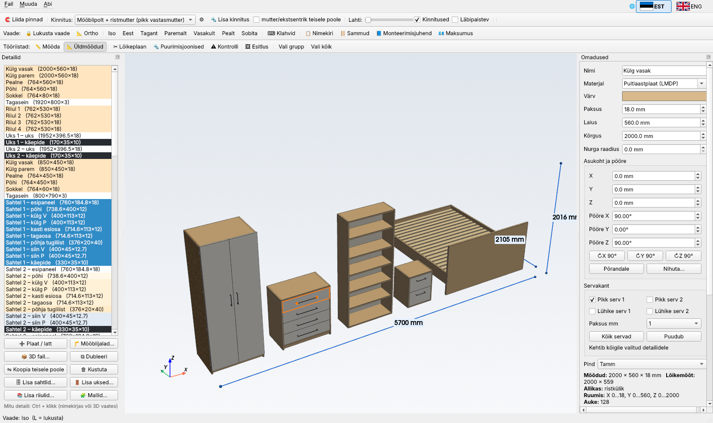
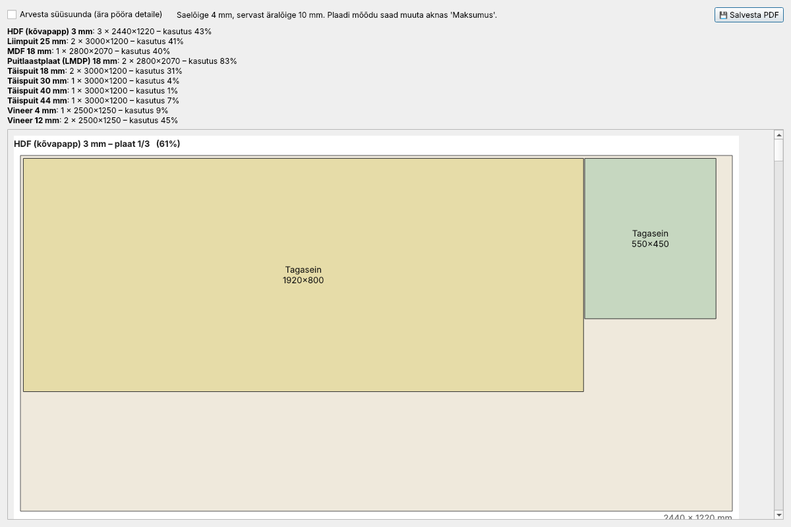
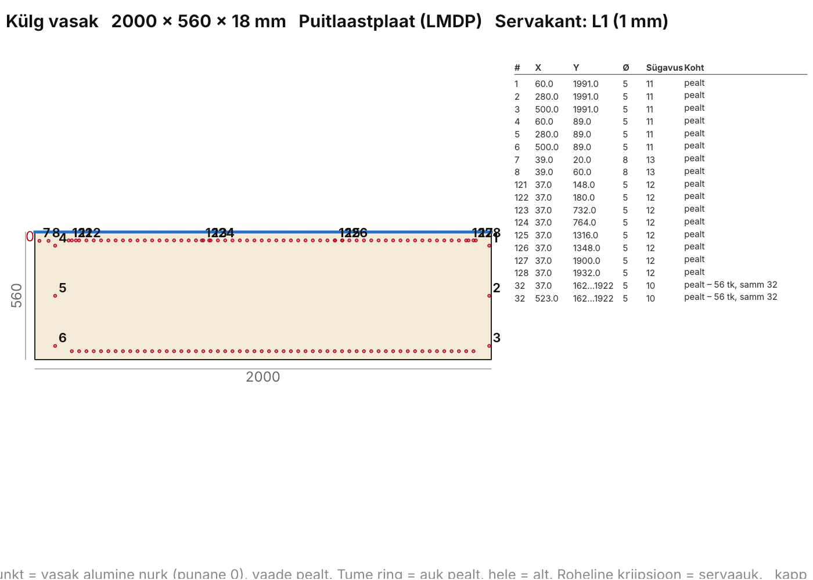
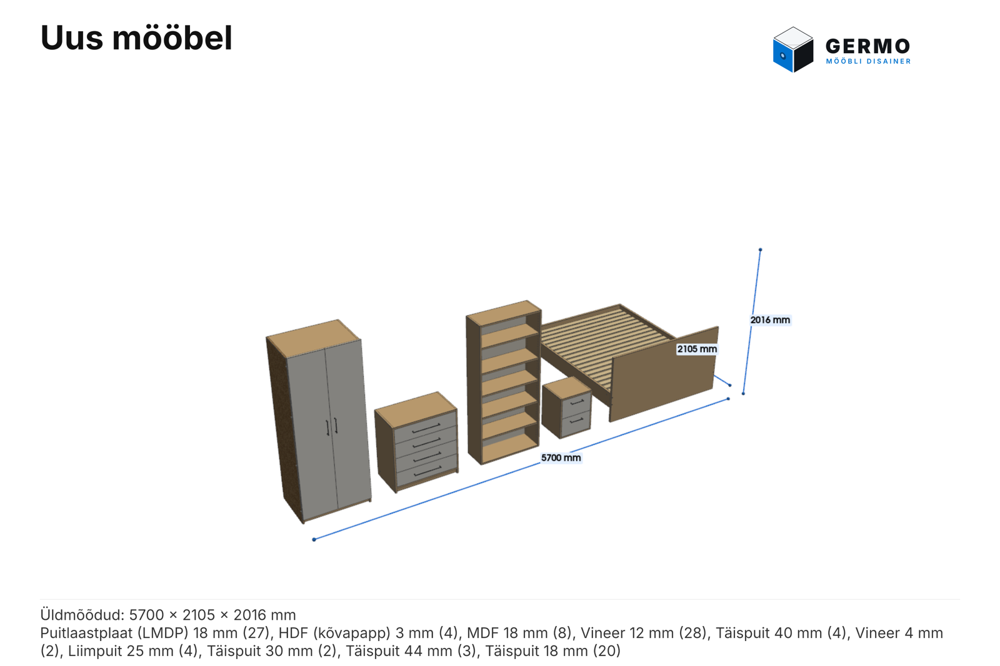

# Furniture-CAD – Germo Mööbli disainer

**Eesti keeles** · [English below](#english)
🚀 Kõige lihtsam viis alustamiseks (soovitatav)

Kui sa ei taha käsitsi paigaldusega jaurata, mine Releases alla, laadi alla eelkompileeritud ZIP-fail, paki see lahti ja käivita Moobel.exe.

Lauaarvutiprogramm (Windows / Linux) mööbli disainimiseks: detailid, mööblikinnitused koos puuritud
aukudega, 3D kokkupanek, monteerimisjuhend, lõikeplaan, puurimisjoonised ja maksumus.
Programmil on eesti ja inglise keel (lipunupud akna paremas ülanurgas).

## Võimalused

**Detailid ja kokkupanek**
- Plaadid ja latid mõõtude järgi. Detailide pinnad võivad olla tamm, pähkel, kask, mänd, saar, valge läige, must matt või betoon.
- 3D-vaade: pööramine (Z jääb üles), vaate lukustamine, ortovaade ja standardvaated (1/2/3/4/7/0).
- **Liida pinnad:** kliki ühel pinnal, siis teisel, ja teine detail keeratakse ning lükatakse esimese vastu.
- Mitme detaili valik (Ctrl + klikk), gruppide valik (G) ja ühine liigutamine, pööramine ning dubleerimine.
- Mõõtmine (D), üldmõõdud 3D-vaates ja kokkupõrgete ning vigaste aukude kontroll.

**Kinnitused (augud puuritakse automaatselt mõlemasse detaili)**
- Mööblipolt + ristmutter, Minifix 15 (veerandpöörde ekstsentrik), konfirmaat, puittüübel, puidukruvi, läbiv polt + kuppelmutter, jalapolt + keermesmuhv.
- Peitehinged (Ø35 kauss) ja riiulikandurite 32 mm süsteemi augud.

**Valmis osad ja mallid**
- **Sahtlid** kahe küljeseina vahele koos siinidega, kasti, põhja, esipaneeli ja käepidemega. Üle 600 mm laiadel sahtlitel on tugevdatud põhi. Saab teha ka klaviatuurisahtli.
- **Uksed** (1 või 2, peale või sisse, ka klaasuks) koos hingedega ja **riiulid** koos 32 mm aukudega.
- **Mööblijalad:** puidust (kandiline, ümar, koonusjas) või metallist (toru kinnitusplaadiga, 3-labaline plaat 6 kruviga, raamjalg).
- **Käepidemed:** 10 stiili, nende tsentrite vahe ja viimistlus on valitavad.
- **Mallid:** kapp, riiul, kummut, öökapp, voodiraam.

**Valmistamiseks**
- **Lõikeplaan:** detailid paigutatakse täisplaatidele, saelõige ja süüsuund on arvestatud (PDF).
- **Puurimisjoonised:** iga detaili augud koos koordinaatide ja sügavustega (PDF).
- **Servakant** iga serva kohta ja lõikemõõdud.
- **Monteerimisjuhend** sammude ja piltidega (PDF + HTML) ning detailide ja kinnituste nimekiri (CSV).
- **Maksumus:** programm täidab kogused, ühikuhinna ja valuuta sisestad ise.
- **Esitluspilt** (PNG/PDF) logo ja mõõtudega.

| Lõikeplaan | Puurimisjoonis | Esitlus |
|---|---|---|
|  |  |  |

## Paigaldamine (Windows)

1. Paigalda **Python 3.10 või uuem** ([python.org](https://www.python.org/downloads/)). Paigaldamisel pane linnuke kasti „Add Python to PATH“.
2. Laadi see repo alla (**Code → Download ZIP**) ja paki lahti.
3. Topeltklikk **`install.bat`** paigaldab vajalikud moodulid (PySide6, pyvista, trimesh, shapely, manifold3d jne).
4. Käivita programm topeltklikiga failil **`Moobel.pyw`** või **`kaivita.bat`** (viimane näitab vigu).

Kiire proov: **Fail → Näidis: kirjutuslaud** või **🧩 Mallid…**

### Oma .exe ehitamine

Pärast `install.bat` käivitamist tee topeltklikk failil **`build_exe.bat`**. Ehitamine võtab 3–10 minutit ja
tulemus on kaustas **`dist\Moobel\Moobel.exe`**. Teisele arvutile andmiseks paki kogu kaust `dist\Moobel` ZIP-iks.
Selles arvutis ei pea siis Pythonit olema. Kui programmi kaustas on `mesa` kaust, kopeeritakse see automaatselt kaasa.

### Vana videokaart või videokaart puudub

3D-vaade vajab OpenGL 3.2 tuge. Kui videokaart seda ei toeta (näiteks Intel HD 2000 või kaugtöölaud), kasutab programm
tarkvaralist OpenGL-i. Selleks:

1. Laadi alla Mesa Windowsi versioon: [pal1000/mesa-dist-win](https://github.com/pal1000/mesa-dist-win/releases) (fail `mesa3d-…-release-msvc.7z`).
2. Kopeeri arhiivi kaustast `x64` failid **`opengl32.dll`** ja **`libgallium_wgl.dll`** programmi kausta alamkausta **`mesa`**.
3. Käivita programm. See valib tarkvaralise režiimi ise. Teise võimalusena kasuta faili `kaivita_tarkvara.bat`.

Graafika valiku tulemus kirjutatakse faili `graafika.txt`.

## Klahvid

| Klahv | Tegevus |
|---|---|
| L / O | lukusta vaade / ortovaade |
| 1 2 3 4 7 0 | eest, tagant, paremalt, vasakult, pealt, iso |
| F | sobita vaatesse |
| M / K / D | liida pinnad / lisa kinnitus / mõõda |
| G / Ctrl+A | vali grupp / vali kõik |
| Nooled, PgUp/PgDn | liiguta valitud detaile (Shift 1 mm, Ctrl 100 mm) |
| Ctrl+Z / Ctrl+Y | tagasi / uuesti |
| F1 / F2 | abi / klahvide nimekiri |

## Failid

- `Moobel.pyw` on käivitusfail, `moobel/` on programmi kood.
- Projektid salvestuvad `.moobel` failidesse (JSON).
- `hinnakiri.json` tekib esimesel kasutamisel ja sinna jäävad sinu sisestatud hinnad. Seda faili repos ei ole.

---

## English
🚀 The easiest way to get started (recommended)

Don't want to deal with manual installation? Simply go to Releases, download the precompiled ZIP file, extract it, and run Moobel.exe.

Desktop program (Windows / Linux) for designing furniture: parts, furniture fasteners with drilled holes,
3D assembly, assembly guide, cutting plan, drilling drawings and cost list. The interface is in Estonian and English
(flag buttons at the top right).

**Features:** panels and battens; joining faces with two clicks; fasteners (cross dowel bolts, Minifix cam locks,
Confirmat screws, dowels, wood screws, hanger bolts) with automatic holes in both parts; drawers with slides, boxes,
fronts and handles; keyboard tray; doors with concealed 35 mm hinges; shelves with 32 mm system holes; wooden and metal
legs; 10 handle styles; templates (cabinet, shelf unit, chest of drawers, bedside table, bed frame); edge banding per
edge; cutting plan (PDF); drilling drawings (PDF); assembly guide (PDF + HTML) and parts list (CSV); cost calculation with
your own prices and currency; presentation image (PNG/PDF); measuring tool, collision and hole checks, surface textures.

**Install (Windows):** install Python 3.10+ (tick “Add Python to PATH”), download this repo, run `install.bat`, then
start `Moobel.pyw` (or `kaivita.bat` to see errors). To build a standalone `Moobel.exe`, run `build_exe.bat`
(result in `dist\Moobel`). Try **File → Sample: desk** or **🧩 Templates…**.

**Old or missing graphics card:** the 3D view needs OpenGL 3.2. Download Mesa for Windows from
[pal1000/mesa-dist-win](https://github.com/pal1000/mesa-dist-win/releases) and copy `x64/opengl32.dll` and
`x64/libgallium_wgl.dll` into a folder named `mesa` next to `Moobel.pyw`. The program then switches to software
rendering automatically (or use `kaivita_tarkvara.bat`).

**Requirements:** see [`requirements.txt`](requirements.txt). Built with PySide6, PyVista/VTK, trimesh, shapely and
manifold3d.
